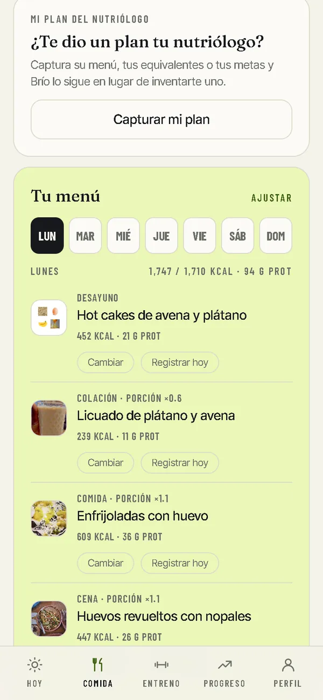
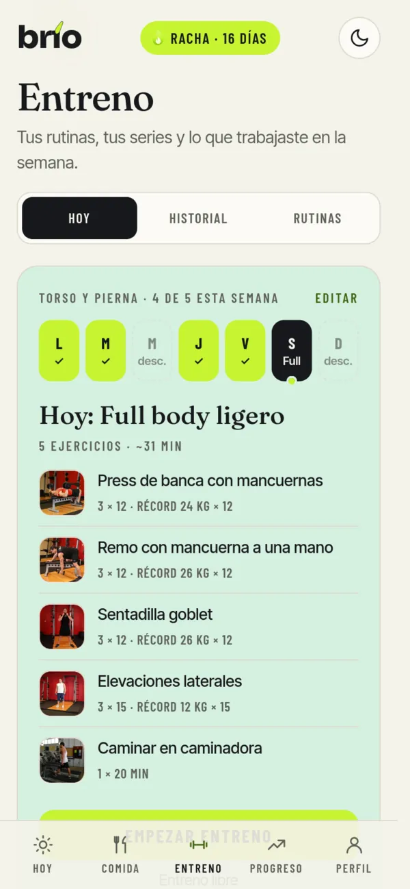
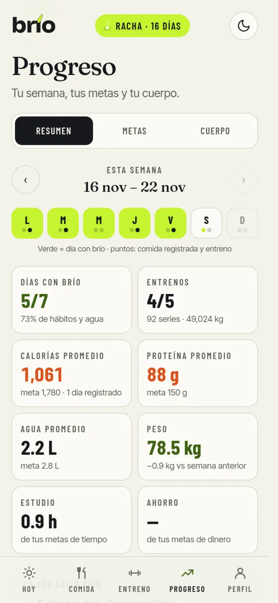
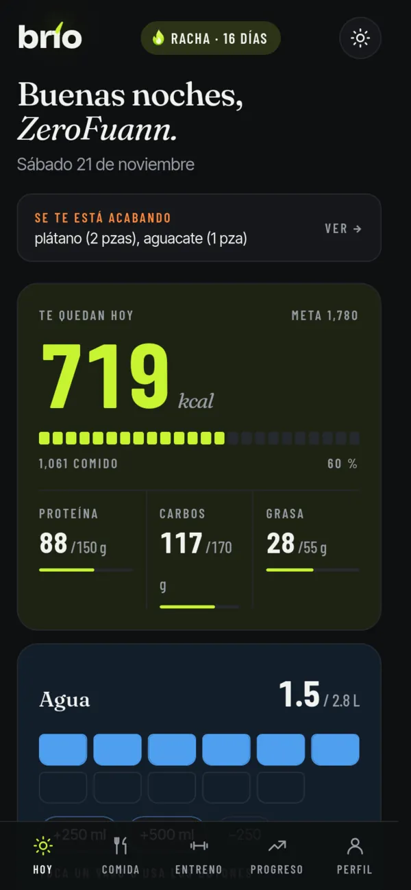
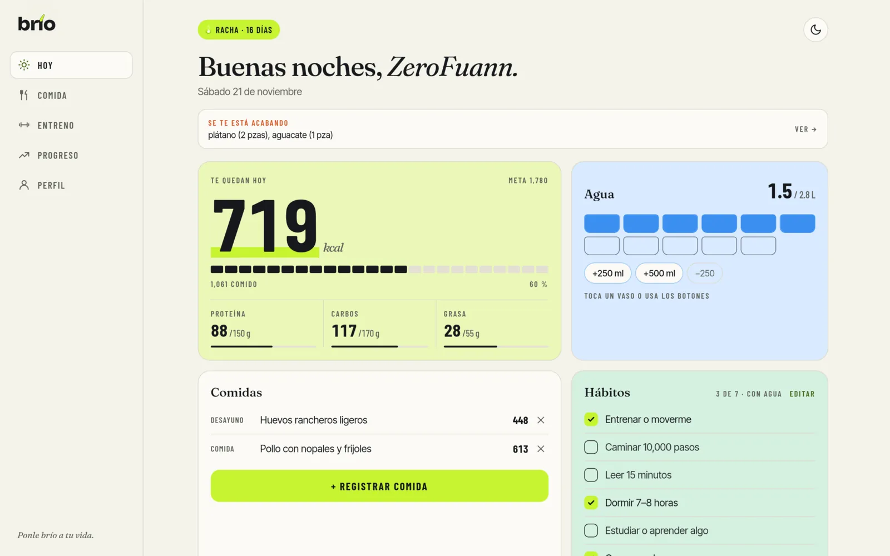
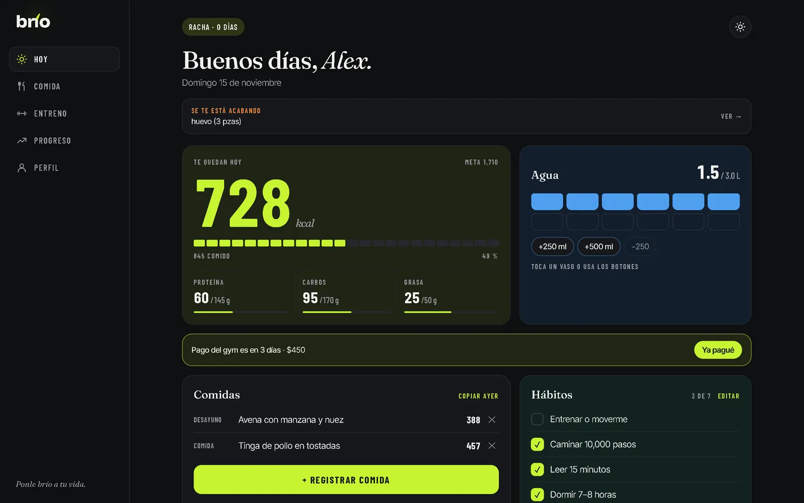
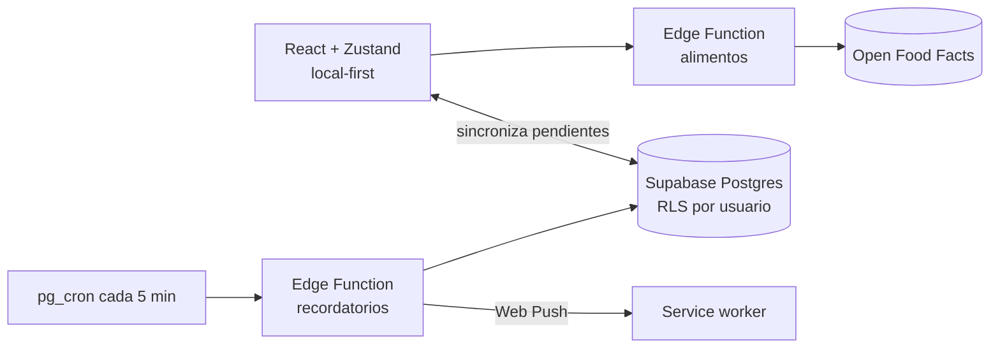

<div align="center">

# brío

**Ponle brío a tu vida.** Comida, gym, hábitos y metas en una sola app.

[**Abrir la app**](https://mi-brio.vercel.app) · [**Conoce Brío**](https://mi-brio.vercel.app/conoce) · [Video](https://mi-brio.vercel.app/conoce#videos)


&nbsp;&nbsp;


</div>

PWA gratuita que junta lo que normalmente requiere varias apps: contar calorías, armar el menú, llevar la rutina del gym, sostener hábitos y avanzar en metas. Pensada para México (recetas caseras, alimentos como se venden aquí y precios de tiendas locales). Funciona en celular y computadora, en modo claro y oscuro, y sin internet.

## Funciones

- **Comida:** buscador con fotos y escáner, menú semanal por reglas, lista del súper y 129 recetas mexicanas.
- **Despensa y nutriólogo:** usa primero lo que tienes en casa; sigue el plan de tu nutriólogo con equivalentes (SMAE).
- **Entreno:** rutinas por días, 173 ejercicios con técnica, series con "la vez pasada", descansos, récords y mapa muscular.
- **Tu día y avisos:** agenda que detecta choques y notificaciones push aunque la app esté cerrada.
- **Progreso:** resumen semanal con consejos, metas de carrera, dinero y aprendizaje, y peso con proyección.
- **Extras:** tutorial animado, comentarios de usuarios, panel de administrador y estadísticas públicas.

## Capturas

| Hoy | Menú | Rutina | Resumen | Modo oscuro |
|---|---|---|---|---|
|  |  |  |  |  |

 

<sub>Capturas con una cuenta de demostración y datos inventados.</sub>

## Tecnología

**React 19 · TypeScript · Vite · Tailwind CSS 4 · Zustand · Supabase (Postgres + RLS, Auth, Edge Functions, pg_cron) · Web Push · Vercel**



## Decisiones técnicas

- **Local‑first:** todo se guarda primero en el dispositivo y funciona sin conexión; los cambios pendientes se sincronizan en lote y lo local gana en caso de conflicto.
- **Seguridad en la base de datos:** Row Level Security en todas las tablas; el panel de administrador usa funciones `security definer` que verifican el rol.
- **Reglas en lugar de IA:** menú, lista del súper y rutinas usan algoritmos propios (gustos, despensa, variedad, costo, equipo), sin costo por uso. La IA está lista detrás de una bandera.
- **Avisos con la app cerrada:** pg_cron llama a una función que calcula los avisos en la zona horaria de cada usuario, los envía por Web Push y evita repetirlos; la misma lógica corre en el navegador sin cuenta.
- **Datos realistas:** alimentos y precios modelados por unidad de compra, para que la lista del súper diga "0.25 kg de chile" y no "1 kg".

<details>
<summary><b>Cómo correrla</b></summary>

```bash
git clone https://github.com/ZeroFuann-FS/brio.git
cd brio && npm install
cp .env.example .env.local   # URL y llave pública de tu proyecto de Supabase
npm run dev
```

Sin variables de Supabase funciona en modo local (sin cuenta ni sincronización). Backend: `supabase db push` aplica `supabase/migrations` y `supabase functions deploy` publica `supabase/functions`.
</details>

<details>
<summary><b>Estructura</b></summary>

```
src/components/   pantallas y componentes (Hoy, Comida, Entreno, Progreso, Perfil…)
src/data/         alimentos, recetas, ejercicios, plantillas, equivalentes
src/lib/          metas, menú, entreno, agenda, sincronización, push
supabase/         migraciones (esquema, RLS, funciones SQL) y Edge Functions
public/           PWA (manifest, service worker, íconos) y página /conoce
```
</details>

<details>
<summary><b>Créditos de datos</b></summary>

USDA FoodData Central (dominio público) · Open Food Facts (ODbL) · free-exercise-db (dominio público) · Wikimedia Commons (licencias libres, créditos en la app) · TheMealDB.
</details>

---

© 2026 ZeroFuann · **Todos los derechos reservados.** Código público solo para consulta como portafolio ([LICENSE](LICENSE)).
