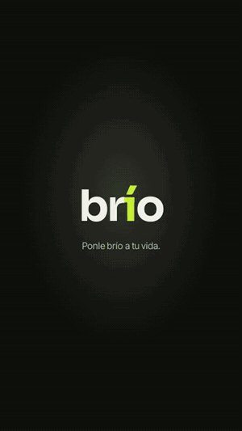
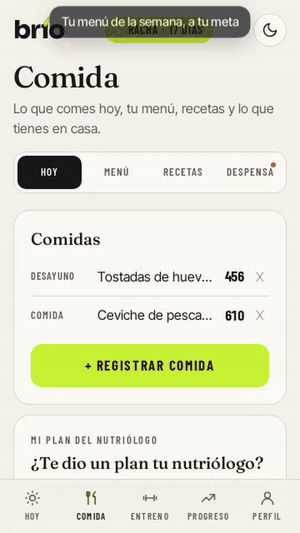
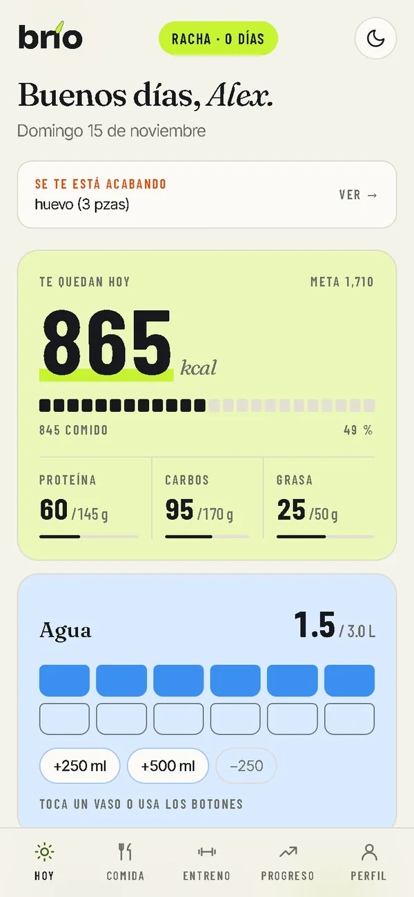
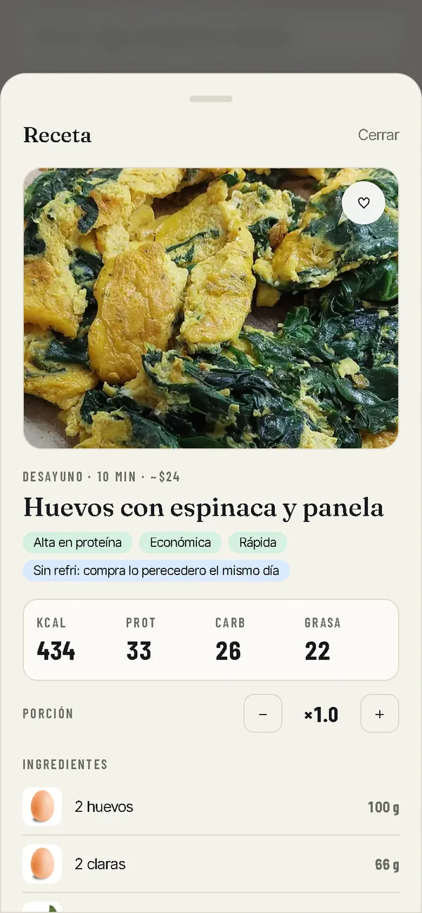
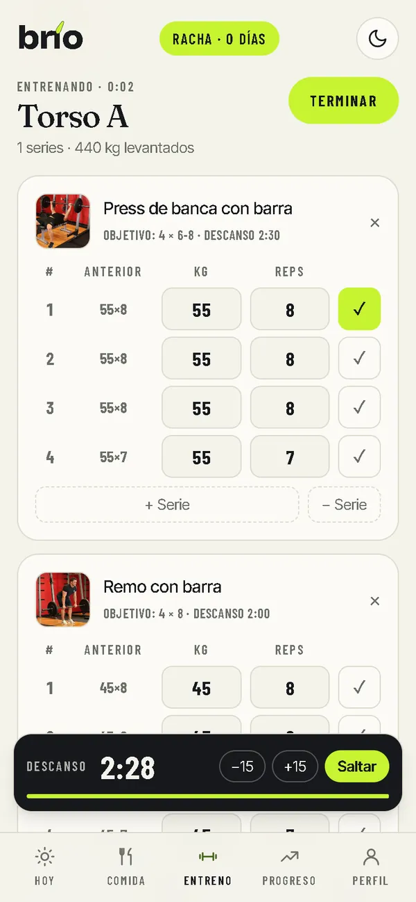
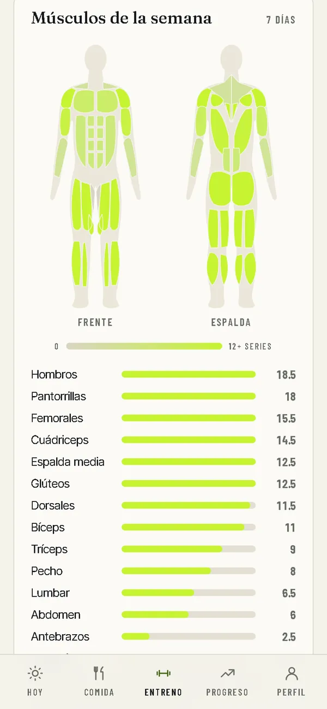
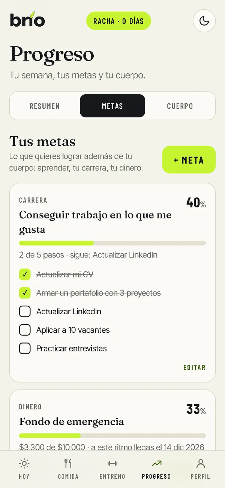
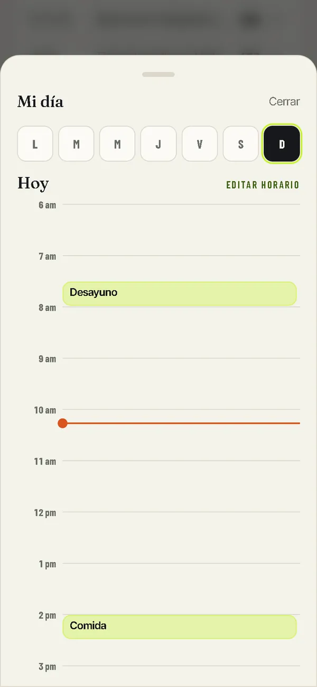
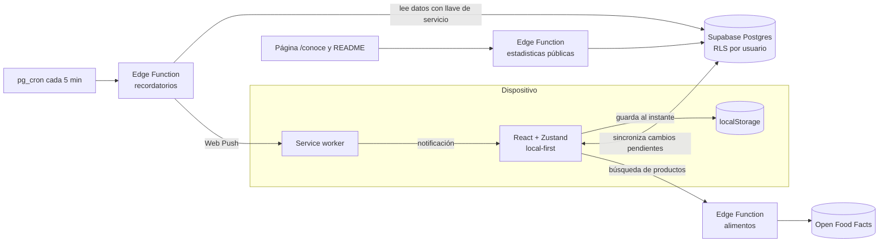

<div align="center">

# brío

**Ponle brío a tu vida.** Comida, gym, hábitos y metas en una sola app.

[**Abrir la app**](https://mi-brio.vercel.app) · [**Conoce Brío**](https://mi-brio.vercel.app/conoce) · [Video](https://mi-brio.vercel.app/conoce#videos)



&nbsp;&nbsp;


</div>

---

## ¿Qué es?

**Brío** es una aplicación web progresiva (PWA) gratuita que junta en un solo lugar lo que normalmente requiere tres o cuatro apps: contar calorías, armar un menú, llevar la rutina del gym, sostener hábitos y avanzar en metas personales.

Está pensada para el día a día en México: recetas caseras y económicas, alimentos como se venden aquí (carne molida, atún en lata, frijoles de olla, de bolsa o de lata, tortillas de la tortillería) y una lista del súper con precios aproximados de tiendas locales.

Funciona en **celular y computadora**, en **modo claro y oscuro**, **sin internet**, y se instala como app desde el navegador.

## Funciones

| | |
|---|---|
| **Hoy** | Meta de calorías y macros calculada (Mifflin‑St Jeor + actividad), agua sin tope, hábitos elegibles y racha de días con brío. |
| **Registrar comida** | Buscador con fotos (base local + Open Food Facts), escáner de código de barras, productos capturados por la comunidad y descuento automático de la despensa. |
| **Menú semanal** | Generador por reglas (sin IA): días, comidas, colaciones y "quién cocina"; ajusta porciones a la meta, respeta gustos, presupuesto y equipo de cocina, y usa primero lo que hay en casa. |
| **Lista del súper** | Suma ingredientes de la semana, resta la despensa y redondea a cómo se compra (cuartos de kilo, piezas, paquetes). |
| **Recetario** | 129 recetas mexicanas con foto, macros, costo y pasos; filtros por rápidas, económicas, sin refri o con lo que tienes. |
| **Plan del nutriólogo** | Metas propias, sistema de equivalentes (SMAE) con conteo automático y menú fijo con "Te toca". |
| **Entreno** | Asistente para elegir rutina, días de la semana, 173 ejercicios con fotos y técnica, registro de series con "la vez pasada", temporizador de descanso, récords (1RM estimado), sugerencia para subir peso y mapa muscular. |
| **Tu día** | Agenda con trabajo/escuela, gym, comidas y tiempo de cocina; detecta choques y horas de sueño. |
| **Avisos** | Notificaciones push (aunque la app esté cerrada): pago del gym, entreno, comidas, despensa, agua, hábitos y resumen del domingo. |
| **Progreso** | Resumen semanal con logros y consejos, metas de carrera/dinero/aprendizaje, peso con proyección y medidas. |
| **Comunidad y admin** | Formulario de comentarios, panel de administrador (usuarios, uso por función, registros por día) y estadísticas públicas. |
| **Tutorial** | Recorrido animado la primera vez y mini guías por sección. |

## Capturas

| Hoy | Menú semanal | Receta | Rutina | Series |
|---|---|---|---|---|
|  |  |  |  |  |

| Músculos | Resumen semanal | Metas | Tu día | Modo oscuro |
|---|---|---|---|---|
|  |  |  |  |  |

 

> Las capturas usan una cuenta de demostración con datos inventados.

## Tecnología

| Capa | Herramientas |
|---|---|
| Interfaz | React 19, TypeScript, Vite 7, Tailwind CSS 4, Motion |
| Estado | Zustand con persistencia local (local‑first) |
| Backend | Supabase: Postgres con Row Level Security, Auth (Google y enlace mágico), Edge Functions (Deno), pg_cron y pg_net |
| Notificaciones | Web Push (VAPID) con service worker propio |
| Despliegue | Vercel (frontend) y Supabase (base de datos y funciones) |
| Datos | USDA FoodData Central, Open Food Facts, free-exercise-db, Wikimedia Commons |

## Arquitectura



## Decisiones técnicas

- **Local‑first.** La app escribe primero en el dispositivo y funciona sin conexión. Cada cambio marca una "clave pendiente" (`perfil`, `dia:2026-11-14`, `sesion:…`) que se sube en lote; al volver la conexión, lo pendiente local gana y lo demás se toma de la nube.
- **Seguridad en la base de datos, no en el cliente.** Todas las tablas tienen Row Level Security: cada usuario solo puede leer y escribir lo suyo. El panel de administrador usa funciones `security definer` que verifican el rol antes de responder.
- **Reglas en lugar de IA para lo esencial.** El menú semanal, la lista del súper y las rutinas funcionan con algoritmos propios (puntaje por gustos, despensa, variedad de proteína, costo y equipo), así que no tienen costo por uso. La IA quedó preparada detrás de una bandera para activarse después.
- **Datos que reflejan cómo se compra.** Los alimentos y precios se modelaron por unidad de compra real, lo que permite una lista del súper útil (por ejemplo, 0.25 kg de chile en lugar de "1 kg").
- **Avisos con la app cerrada.** Una tarea de pg_cron llama cada 5 minutos a una función que calcula los avisos de cada usuario en su zona horaria y los envía por Web Push, con registro para no repetirlos y un freno contra llamadas excesivas. La misma lógica (compartida) se usa en el navegador para quien no tiene cuenta.
- **Diseño propio.** Sistema de diseño con tokens para modo claro y oscuro, tipografías Fraunces, Barlow Condensed e Inter Tight, y un mapa muscular en SVG dibujado para la app.

## Cómo correrla

```bash
git clone https://github.com/ZeroFuann-FS/brio.git
cd brio
npm install
cp .env.example .env.local   # pon la URL y la llave pública de tu proyecto de Supabase
npm run dev
```

Sin variables de Supabase la app funciona en modo local (sin cuenta ni sincronización).

Para el backend: `supabase db push` aplica las migraciones de `supabase/migrations` y `supabase functions deploy` publica las funciones de `supabase/functions`.

## Estructura

```
src/
  components/      pantallas y componentes (Hoy, Comida, Entreno, Progreso, Perfil…)
  data/            alimentos, recetas, ejercicios, plantillas, equivalentes
  lib/             cálculo de metas, menú, entreno, agenda, sincronización, push
supabase/
  migrations/      esquema, RLS y funciones SQL
  functions/       alimentos, recordatorios, estadisticas, ia (+ _shared)
public/            PWA (manifest, service worker, íconos) y página /conoce
```

## Créditos

- Valores nutricionales de referencia: **USDA FoodData Central** (dominio público).
- Productos de marca: **Open Food Facts** (ODbL).
- Ejercicios e imágenes: **free-exercise-db** (dominio público).
- Fotos de platillos e ingredientes: **Wikimedia Commons** (licencias libres; créditos dentro de la app) y **TheMealDB**.

## Licencia

© 2026 ZeroFuann. **Todos los derechos reservados.** El código es público solo para consulta como portafolio; no se permite copiarlo ni usarlo sin autorización. Ver [LICENSE](LICENSE).
